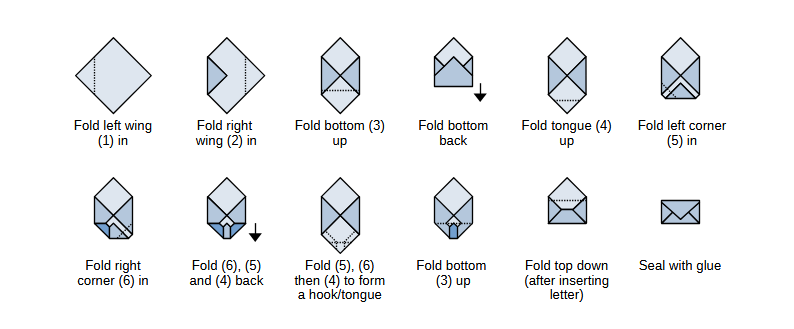

# Envelope

Nothing fancy, just a python script that can generate a fold-it-yourself envelope on A4 paper

## Usage
Show the help with
 ```sh
  envelope.py -h
```


Example:  
Make all the addresses in *wedding.txt* into envelopes and place them in the directory **wedding_envelopes/**. Print the return address from *my_address.txt* on all of them. Include the "Please, do not bend" stamp and use ink save mode.
 ```sh
  envelope.py -i wedding.txt -o wedding_envelopes -r my_address.txt -b -s
```

Take a look at **examples/** for how to write input and address files.

## "Install"

  Make a .bat file with the following content

  ```bat
  @echo off
  python [path]\envelope.py %*
  ```

  and place it anywhere in your PATH.
  
## Folding instructions

