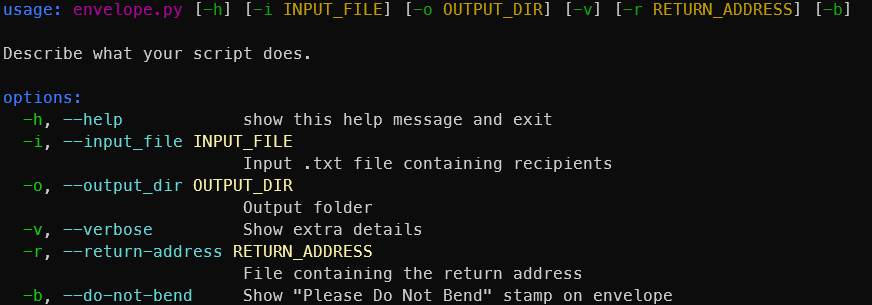

# Envelope

Nothing fancy, just a python script that can generate a fold-it-yourself envelope on A4 paper

## Usage
 ```sh
  envelope.py -h
```


Take a look at examples/

## "Install"

  Make a .bat file with the following content

  ```bat
  python [path]\envelope.py %*
  ```

  and place it anywhere in your PATH.
  
